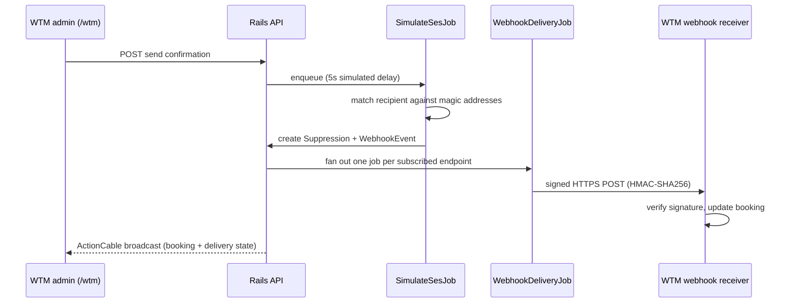

# Nitrosend Webhooks Demo

A working prototype of a feature Nitrosend advertises but doesn't have: outbound webhooks for email-suppression events.

## The gap this fills

When a send bounces or triggers a spam complaint, Nitrosend suppresses the address internally and stops sending to it — but never tells the application that triggered the send. That app's database still thinks the message went out fine. The marketing site and API docs describe a mature webhook system (HMAC-signed payloads, retry policy, an event taxonomy) that has no corresponding implementation — no `Webhook` model, no endpoint anywhere in the API.

That gap was checked against the live product before treating it as real, not just assumed from the docs: sending to a bouncing address does get suppressed internally (the address stops receiving further mail, and Nitrosend's own dashboard reflects the bounce), but nothing in the public API — no webhook, no callback, no polling endpoint — tells the app that originated the send. Short of manually re-checking every recipient's status by hand, the sending app has no way to learn its message never arrived.

This repo builds the missing half: a Nitrosend-styled admin UI for configuring webhook endpoints with real HMAC-signed deliveries and retry logic, plus WeTeachMe (WTM), a small downstream-app stand-in that receives and acts on those webhooks — so you can see both sides of the integration.

## Try it

**https://nitrosend-webhooks-demo.fly.dev/**

Each visitor gets an isolated workspace on first request (a signed cookie, no login), so you won't see other reviewers' data. Idle workspaces are purged after 24 hours.

### 60-second demo script

1. Go to [`/wtm`](https://nitrosend-webhooks-demo.fly.dev/wtm) — the WeTeachMe booking admin.
2. Click **Send confirmation** on a booking, or edit its email to `bounce@simulator.demo` first.
3. Wait ~5 seconds (simulated SES delay). The booking flips to **Email failed — 550 5.1.1 user unknown**, live, no refresh.
4. Go to [`/`](https://nitrosend-webhooks-demo.fly.dev/) — the Nitrosend webhooks UI — and open the seeded endpoint.
5. Watch the delivery land in the log, live. Open it for the full signed request/response detail.

### Magic simulator addresses

There's no real SES behind this — a mock send API routes on the recipient address:

| Address | Effect | Suppresses? | Webhook fired |
|---|---|---|---|
| `bounce@simulator.demo` | hard bounce | yes | `hard_bounce` |
| `softbounce@simulator.demo` | soft bounce | no | `soft_bounce` |
| `complaint@simulator.demo` | spam complaint | yes | `complaint` |
| anything else | delivered normally | no | none |

Matching is case-insensitive.

## Architecture

Rails 8.1 app (Postgres + Redis) with a Vue 3 SPA served through vite_rails. Two route namespaces share one backend: `/` and `/endpoints/*` are the Nitrosend admin, `/wtm` is the WeTeachMe stand-in. GoodJob (Postgres-backed) runs the job queue; Redis is used only for ActionCable, not for queueing.



Pipeline in prose: mock send API → `SimulateSesJob` (magic-address routing) → creates a `Suppression` + `WebhookEvent` → fans out one `WebhookDeliveryJob` per subscribed endpoint → real signed HTTP POST → receiver verifies the signature and updates its own record → every state change broadcasts live over ActionCable to both UIs.

Key files:

- `app/jobs/simulate_ses_job.rb` — magic-address routing, suppression + event creation
- `app/jobs/webhook_delivery_job.rb` — signs and sends the HTTP POST, owns the retry schedule
- `app/services/webhooks/signer.rb` — HMAC signing/verification, secret rotation grace window
- `app/services/webhooks/url_guard.rb` — SSRF guard on outbound delivery targets
- `app/controllers/wtm/webhooks_controller.rb` — the receiver side: verifies signatures, updates bookings
- `app/frontend/pages/WebhooksList.vue`, `EndpointDetail.vue`, `WtmBookings.vue` — the two UIs

The webhook endpoint seeded into every new workspace points at that workspace's own `/wtm/webhooks/:token` receiver, so the demo is a closed loop by default — no external service required to see it work.

## Local setup

Requires Ruby (version pinned in `.ruby-version`, currently 3.4.9), Node (`.node-version`, 20.19.6), PostgreSQL, and Redis running locally.

```bash
bin/setup   # bundle install, db:prepare, clears logs/tmp
bin/dev     # runs Puma; vite_rails builds assets in-process (autoBuild)
```

`bin/setup` accepts `--reset` to wipe and reseed the database, and `--skip-server` to stop before launching `bin/dev`.

## Environment variables

- `RAILS_MASTER_KEY` — decrypts `config/credentials.yml.enc`; required in production.
- `DATABASE_URL` — Postgres connection string; falls back to local defaults in `config/database.yml` when unset.
- `REDIS_URL` — ActionCable's pubsub backend in production; defaults to `redis://localhost:6379/1`.
- `HTTP_PORT` — port Thruster proxies to in production (see `fly.toml`); Puma binds here instead of the default.
- `APP_URL` (optional) — an extra allowed ActionCable origin, alongside the `*.fly.dev` pattern.

## Tests

```bash
bundle exec rspec   # backend: 58 examples
npm test             # frontend: Vitest
```

RSpec covers models, jobs, the signing and SSRF-guard services, the JSON API, ActionCable, and one full-loop Capybara system test (`spec/system/full_loop_spec.rb`) that drives a bounce from send through webhook delivery to the receiver updating its own record. Vitest covers frontend store logic.

## Payload and signature verification

Every delivery attempt sends these headers alongside a JSON body:

```
Content-Type: application/json
X-Nitrosend-Event: hard_bounce
X-Nitrosend-Timestamp: 1755000000
X-Nitrosend-Signature: <hex HMAC-SHA256>
```

Signature:

```
signature = HMAC-SHA256(secret, "#{timestamp}.#{body}")   # hex digest
```

From `app/services/webhooks/signer.rb`:

```ruby
def self.signature(secret:, timestamp:, body:)
  OpenSSL::HMAC.hexdigest("SHA256", secret, "#{timestamp}.#{body}")
end
```

Verification requires the timestamp to be within 5 minutes of receipt (`Signer::TOLERANCE`), and compares against the current signing secret plus, for 24 hours after a rotation, the previous one — so rotating a secret doesn't drop in-flight deliveries.

Retries on non-2xx or connection failure follow a fixed schedule — 30s, 2m, 10m, 30m — for up to 5 attempts total, then the delivery is marked `failed` (`WebhookDeliveryJob::RETRY_SCHEDULE`).

Payload shape (`app/services/webhooks/payload.rb`):

```json
{
  "event_id": "evt_123",
  "event_type": "hard_bounce",
  "occurred_at": "2026-08-12T10:00:00Z",
  "message_id": "msg_abc123",
  "recipient": "bounce@simulator.demo",
  "reason": "550 5.1.1 user unknown",
  "data": { "bounce_type": "Permanent", "diagnostic_code": "smtp; 550 5.1.1 user unknown" }
}
```

Outbound delivery targets are checked against `Webhooks::UrlGuard` before every send, which rejects URLs resolving to private or reserved IP ranges (loopback, link-local, RFC1918, etc.), with a narrow `localhost` carve-out outside production. This is a real security property, not a stub — this demo makes genuine outbound HTTP requests to whatever endpoint you register, so it needs an SSRF guard the same way a production system would.

## Out of scope

Scoped narrowly to suppression events on purpose — see the "What this demo covers" section of the finding for the reasoning. Not included:

- The broader `sent/delivered/opened/clicked` event taxonomy beyond bounce and complaint
- Per-brand endpoint scoping beyond a single workspace
- UI for replaying historical events
